# AgriSense 智慧农业监测系统

> 让农业更智慧，让丰收更简单。

基于 **ESP32 + MQTT + Flask + SQLite + jQuery + ECharts** 的全栈智慧农业平台，覆盖「感知 → 决策 → 控制 → 可视化 → 溯源 → 资讯」完整闭环：从土壤墒情单点监测起步，扩展为多参数环境感知、规则引擎智能决策、执行器远程控制、数据大屏、农产品溯源、AI 病害识别、农业知识库与新闻资讯、移动端 H5 的一体化系统。

## 功能总览

| 模块 | 说明 |
|------|------|
| 监测仪表盘 | 实时墒情/温湿度/光照卡片、24 小时趋势图、执行器状态面板 |
| 实时监测 | 4 指标仪表盘 + 实时数据流图 + 采集记录表（5 秒刷新） |
| 历史分析 | 多指标趋势对比、分页查询、CSV 导出 |
| 气象服务 | 6 城市切换、当前天气、24 小时温度/降水曲线、7 天预报、农事适宜度与气象预警 |
| 天气驱动灌溉 | 灌溉决策接入降雨预报，降雨概率 ≥60% 自动推迟灌溉并计算节水建议 |
| 设备管理 | 多监测节点 CRUD、在线/离线状态监控 |
| 灌溉管理 | 灌溉调度 CRUD、手动控制、灌溉日志统计 |
| 告警中心 | 告警列表与处理、告警规则管理（阈值可配置） |
| 规则引擎 | 后台线程周期评估多条件规则，自动触发告警与设备联动 |
| 数据大屏 | 深色主题一张图：地块热力、趋势、设备状态、告警跑马灯 |
| 溯源管理 | 批次码 + 农事日志 + 溯源时间线 + 二维码生成 |
| 病害识别 | 拍照上传 → AI 识别（模拟分类器）→ 病害类型 + 置信度 + 防治建议 |
| 农业知识库 | 种植技术 / 病虫害防治 / 水肥管理 / 智慧农业四大分类，支持搜索 |
| 农业新闻 | 政策 / 行业 / 科技 / 行情资讯，头条 + 阅读量统计 |
| 企业站点 | 关于我们、客服中心（在线留言）、问题解答、隐私政策 |
| 移动端 H5 | 墒情环形图、环境参数、一键灌溉、告警推送 |
| 用户与权限 | 管理员 / 操作员 / 访客三角色 RBAC、PBKDF2 加盐密码、会话令牌鉴权、用户管理页 |
| 数据统计报表 | 环境日均值、灌溉活动、告警分布、农事记录、溯源批次多维图表；操作员及以上权限，支持近 7/14/30 天切换 |

## 页面截图

### 监测仪表盘

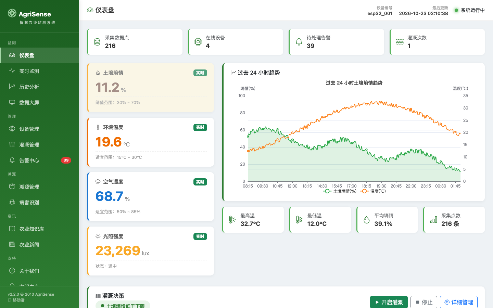

### 气象服务

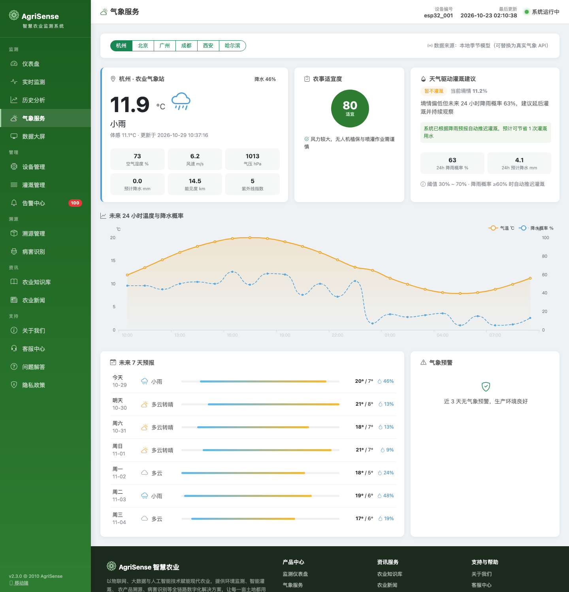

### 数据大屏

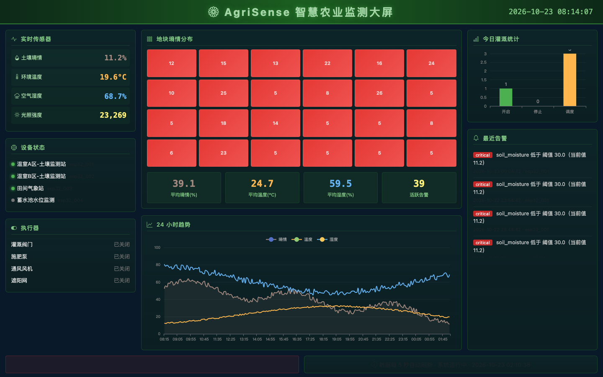

### 溯源管理

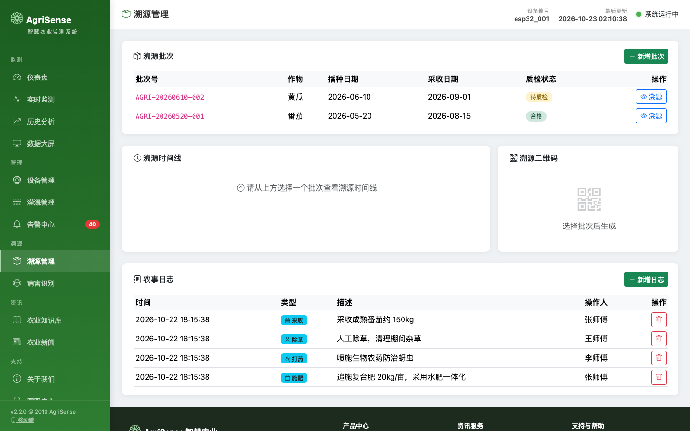

### 病害识别

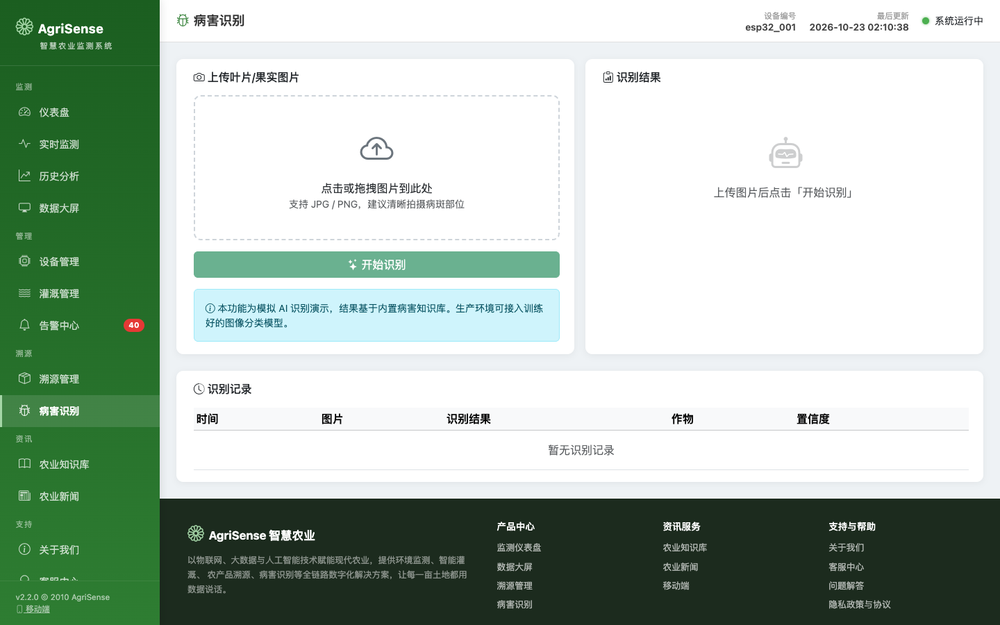

### 农业知识库

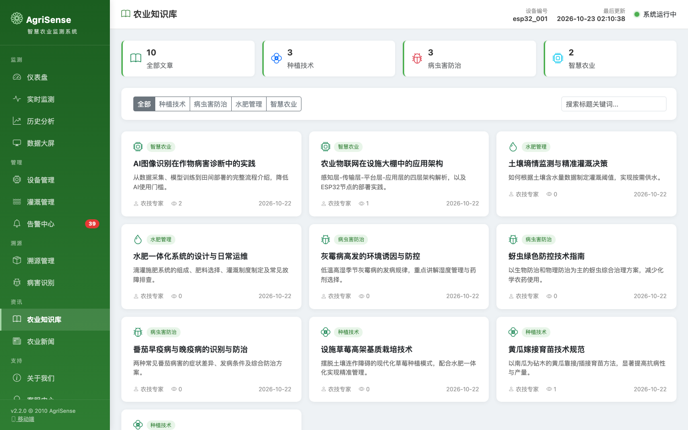

### 农业新闻

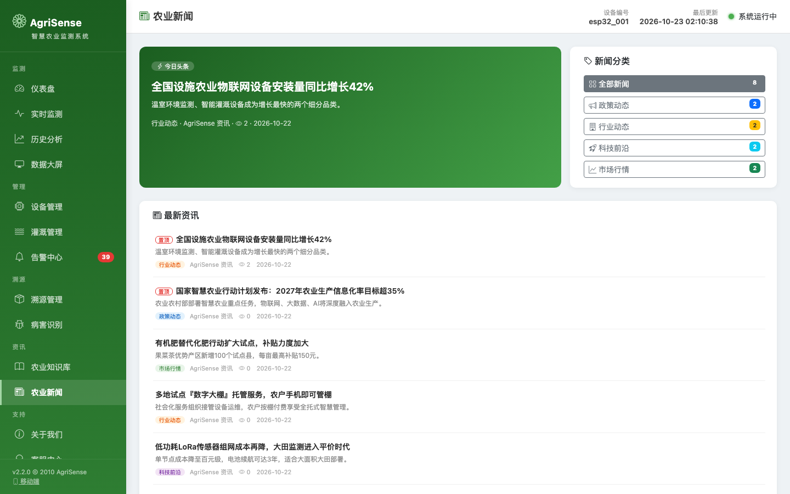

### 关于我们

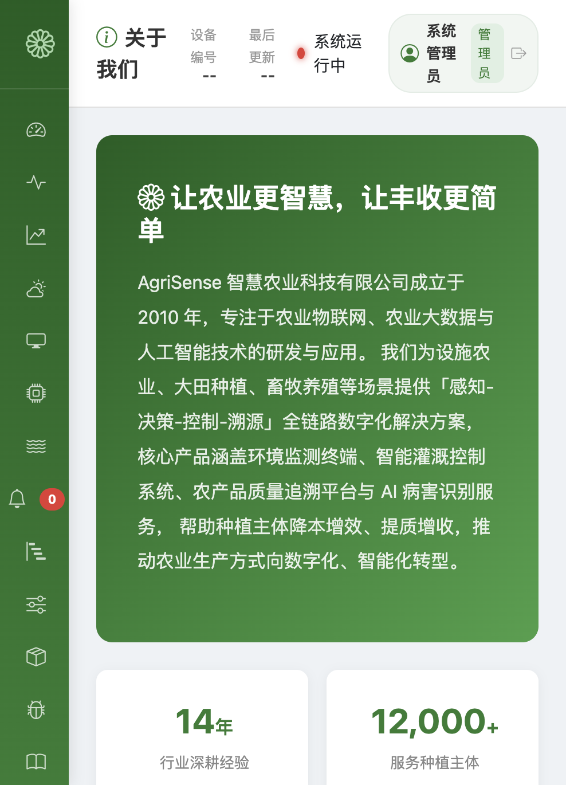

### 移动端 H5

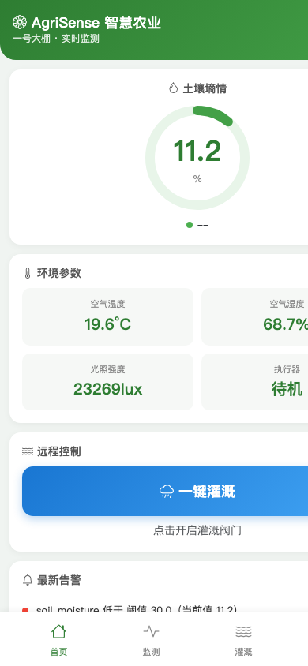

### 登录页

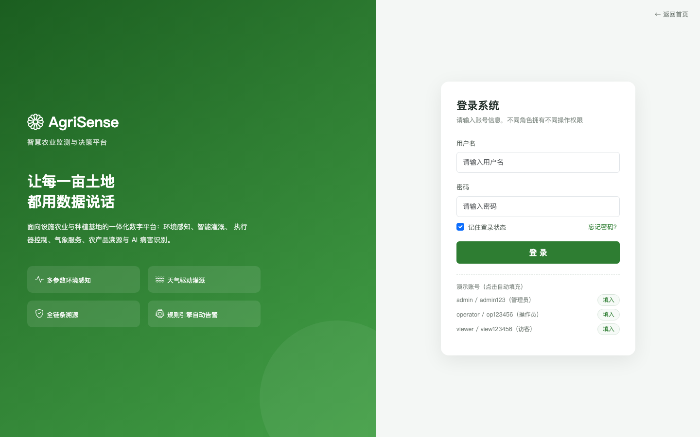

### 用户与权限管理

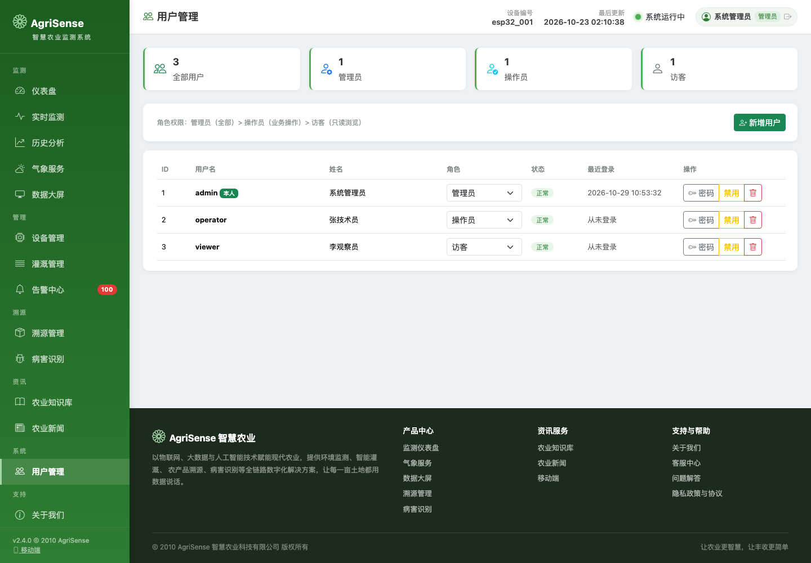

### 数据统计报表

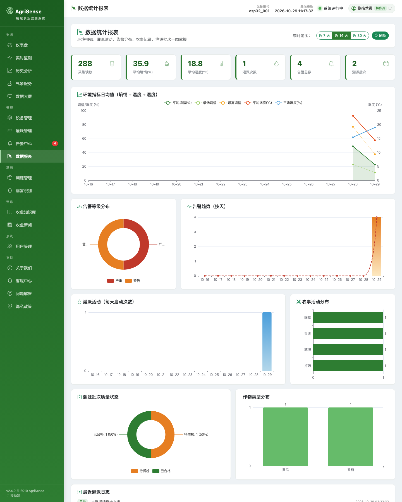

## 系统架构

```
感知层            传输层           平台层                    应用层
─────────        ─────────       ─────────────────       ─────────────────
ESP32 传感器  →   MQTT Broker  →  Flask API + SQLite  →   Web 多页面管理端
土壤墒情          mosquitto        规则引擎(30s 周期)      数据大屏
温湿度/光照                         灌溉决策逻辑            移动端 H5
执行器(继电器) ←  MQTT 指令  ←      执行器状态机          溯源二维码
```

- **感知层**：ESP32 采集土壤墒情、空气温湿度、光照强度，通过 WiFi 以 MQTT 上报；接收控制指令驱动继电器（阀门/肥泵/风机/遮阳网）
- **平台层**：Flask 提供 REST API，SQLite 持久化（传感器读数、设备、告警、规则、调度、执行器、农事日志、溯源批次、知识库、新闻、留言、用户、会话共 15 张表）；规则引擎每 30 秒评估规则并自动告警；RBAC 三角色鉴权保护管理类接口
- **应用层**：jQuery + Bootstrap 5 + ECharts 多页面应用，共享侧边栏布局与页脚，独立移动端 H5

## 技术栈

| 层 | 技术 |
|----|------|
| 固件 | Arduino / ESP32、PubSubClient（MQTT）、DHT22、BH1750 |
| 后端 | Python 3.7+、Flask、Flask-CORS、paho-mqtt、SQLite3 |
| 前端 | jQuery、Bootstrap 5、Bootstrap Icons、ECharts |
| 通信 | MQTT（传感器上行 / 控制下行）、HTTP REST（页面数据） |

## 快速开始

```bash
# 1. 启动 MQTT Broker（需已安装 mosquitto）
mosquitto -p 1883 &

# 2. 启动后端（端口 5001）
cd agri-sense/backend
pip install -r requirements.txt
python3 seed_mock_data.py   # 可选：写入演示数据
python3 app.py

# 3. 启动前端（端口 8080）
cd agri-sense/frontend
python3 -m http.server 8080

# 4. 访问
open http://localhost:8080/index.html    # 管理端
open http://localhost:8080/screen.html   # 数据大屏
open http://localhost:8080/mobile.html   # 移动端
```

ESP32 固件位于 `agri-sense/firmware/`，修改 WiFi 与 MQTT Broker 地址后刷入即可接入真实硬件；无硬件时可用 `seed_mock_data.py` 生成的模拟数据体验全部功能。

### 演示账号

| 用户名 | 密码 | 角色 | 权限 |
|--------|------|------|------|
| admin | admin123 | 管理员 | 全部功能 + 用户管理 |
| operator | op123456 | 操作员 | 监测/设备/灌溉/告警等业务操作 |
| viewer | view123456 | 访客 | 只读浏览 |

未登录也可浏览监测类页面，访问 `users.html` 会自动引导到登录页。

## 项目结构

```
agri-sense/
├── backend/            # Flask 后端
│   ├── app.py          #   REST API + MQTT 订阅 + 规则引擎 + 报表接口
│   ├── database.py     #   SQLite 操作层（15 张表 + 聚合统计）
│   ├── config.py       #   配置（端口/MQTT/阈值）
│   ├── irrigation_logic.py  # 灌溉决策（含天气联动）
│   ├── weather_service.py   # 气象模型（可替换真实气象 API）
│   └── seed_mock_data.py    # 演示数据生成
├── frontend/           # jQuery 多页面前端
│   ├── js/layout.js    #   共享侧边栏 + 顶栏登录态 + 页脚布局
│   └── *.html          #   20 个页面（含登录页、用户管理、数据报表）
├── firmware/           # ESP32 固件
└── docs/screenshots/   # 页面截图
```

## 版本历史

| 版本 | 内容 |
|------|------|
| v0.1 ~ v0.8 | 后端/前端/固件基础、MQTT 打通、多参数感知 |
| v1.0 ~ v1.5 | 多页面架构、实时监测、历史分析、设备/灌溉/告警管理 |
| v1.6 ~ v1.8 | 规则引擎、执行器系统、数据大屏 |
| v1.9 | 溯源管理（批次 + 农事日志 + 时间线 + 二维码） |
| v2.0 | 病害识别（模拟 AI）+ 移动端 H5 |
| v2.1 | 农业知识库 + 农业新闻资讯中心 |
| v2.2 | 企业站点（关于/客服/FAQ/隐私）+ 全站共享页脚 |
| v2.3 | 气象服务（6 城市 / 24 小时 / 7 天预报 / 农事指数）+ 天气驱动灌溉决策 |
| v2.4 | 用户登录与权限体系（三角色 RBAC + PBKDF2 加盐密码 + 会话令牌 + 用户管理页） |
| v2.5 | 数据统计报表（环境/灌溉/告警/农事/批次多维 ECharts 图 + 日期范围切换 + 操作员权限保护） |

## License

[MIT](LICENSE)
